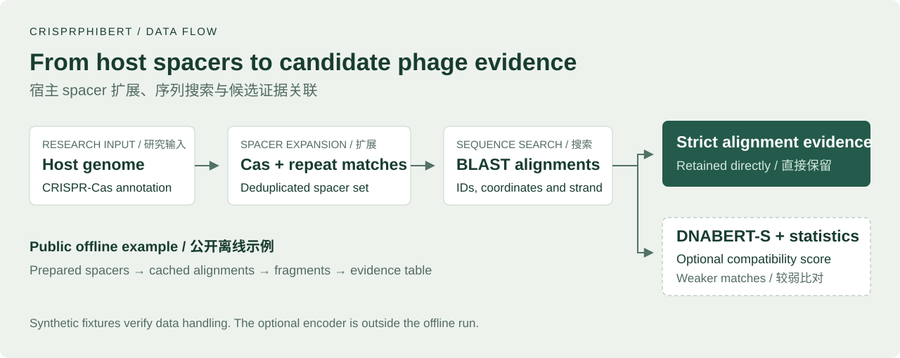
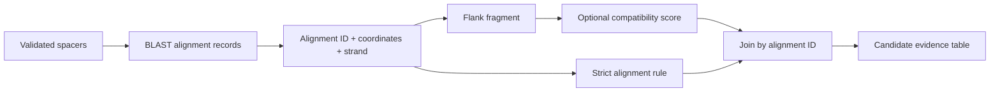
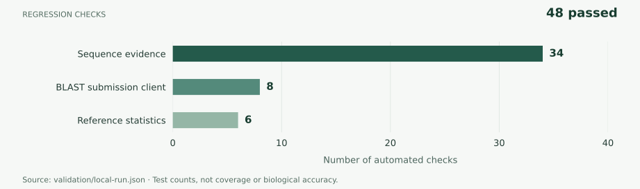
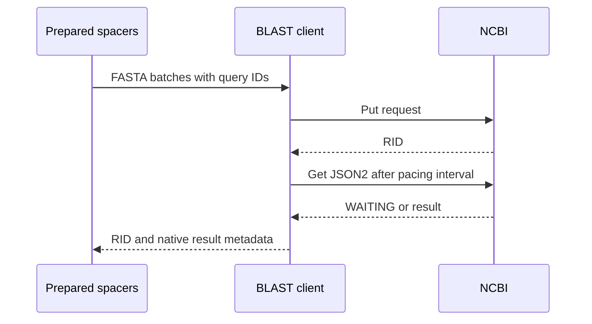

# CRISPRPHIBert

**Phage–host candidate prediction from CRISPR sequence evidence**

[English](README.md) · [简体中文](README.zh-CN.md) · [Workflow](docs/WORKFLOW.md) · [Validation](docs/VALIDATION.md) · [Sources](SOURCE-NOTICE.md)

[](https://github.com/CatAlvin/CRISPR-PHI-Bert/actions/workflows/check.yml)



CRISPR spacers are short DNA sequences stored by bacteria and archaea after encounters with foreign genetic material. CRISPRPHIBert starts from a host genome, expands its spacer set through Cas protein homology and repeat agreement, then searches for candidate phage sequences with BLAST. DNABERT-S embeddings provide a second source of sequence evidence for weaker alignments.

This repository presents the sequence-processing and integration stages in runnable Python code. It includes an offline example, an NCBI submission client and the reference-distribution scoring module. The example uses **synthetic sequences, cached alignment fixtures and manually supplied scores** to make each intermediate step inspectable.

## My contribution

I am **Bohan Wu / 吴博涵**, a member of the CRISPRPHIBert team. My work in the research project covered data preprocessing, the BLAST upload workflow and part of the data-flow integration. I helped connect sequence inputs and intermediate alignment results to downstream analysis.

| Area I worked on | What the public implementation makes visible |
|---|---|
| Data preprocessing | FASTA validation, sequence deduplication and spacer provenance in [`evidence.py`](crisprphibert/evidence.py) |
| BLAST upload workflow | Batches constrained by bases and record count; request IDs and paced retrieval in [`ncbi.py`](crisprphibert/ncbi.py) |
| Data-flow integration | Alignment IDs carried into fragment extraction, score joins and candidate output in [`__main__.py`](crisprphibert/__main__.py) |

The project was supervised by **Dr. Dan Wang / 王丹老师**. The team comprises **祁琛、陈乐怡、黄子倩、吴博涵、刘昇瑞**. The biological method and model components are team and upstream work. This public version was prepared from archived project material in October 2026; its refactoring and regression suite are documented in the [change record](docs/CHANGES.md).

## Following one alignment through the pipeline

The integration key is an **alignment ID**, rather than a candidate genome ID. Two matches on the same genome can therefore keep different fragments and scores. Strict alignments are retained even when a supplemental score is unavailable.



The statistical stage uses **DNABERT-S**, followed by two-component PCA, a three-component Gaussian mixture with tied covariance and Mahalanobis distance. It measures compatibility with fragments from strict alignments. The score is uncalibrated; interpreting it as an infection probability requires a labelled biological evaluation. See the [scoring formula and sequence contracts](docs/WORKFLOW.md).

## Run the offline example

From a checkout, use **Python 3.11 or later**. The sequence example requires only the standard library.

```bash
python -m crisprphibert --demo --outdir demo-output
python scripts/verify_demo.py --output demo-output
```

Open `demo-output/report.html` to inspect the alignment table. [`sample-output/`](sample-output/) contains the checked-in reference output; the command refuses to overwrite an existing directory.

| Synthetic fixture stage | Records |
|---|---:|
| Input spacers | 3 |
| Unique spacers after expansion | 7 |
| Cached alignments | 6 |
| Strict / illustrative-score-supported / unresolved alignments | 3 / 1 / 2 |

These counts describe the example's branches. They are **engineering validation data**, not experimental yield, accuracy or a measured improvement from DNABERT-S. The main example does not execute the encoder.

For the statistical module and the complete test suite:

```bash
python -m pip install -e ".[statistics]"
python -m unittest discover -s tests -v
python scripts/score_embeddings.py --output demo-output/statistics.json
```

## Verification



**48 regression checks** passed in the recorded local run. Of these, **42** exercise sequence processing and the upload client without optional scientific libraries; **6** exercise the statistical module. The chart counts tests, rather than code coverage or biological accuracy. [Machine-readable record](validation/local-run.json).

The NCBI client is checked with mocked responses. The local encoder adapter is provided for a reviewed DNABERT-S snapshot; real-weight inference and the complete genome-to-prediction workflow are outside this validation run. [Validation details](docs/VALIDATION.md).

## BLAST submissions

The upload client preserves query IDs and the returned request identifier (RID). Its defaults limit a batch to **1,000 bases and 25 records**. Within one client, it enforces at least **10 seconds between requests** and **60 seconds between retrievals for the same RID**, following [NCBI's usage guidance](https://blast.ncbi.nlm.nih.gov/doc/blast-help/developerinfo.html).



Retrieval timing is scheduled by the caller. Live JSON2 responses remain in their native form; the offline analysis consumes the documented 12-column alignment format.

## Sources and attribution

The research workflow builds on CRISPRinter/PAMPHLET and uses tools from the CRISPR annotation and sequence-search ecosystem. DNA representations come from [DNABERT-S](https://github.com/MAGICS-LAB/DNABERT_S), developed by its upstream authors. The [source notice](SOURCE-NOTICE.md) records team credit, related work and software registration **2025SR1133680** as supplied by the contributor. Upstream components retain their own terms; this repository does not introduce an open-source license for them.
