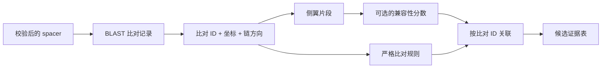
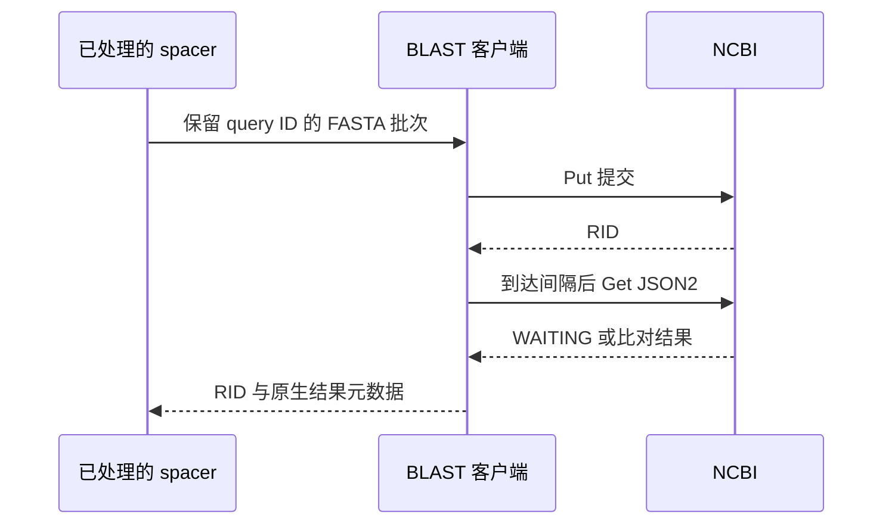

# CRISPRPHIBert

**基于 CRISPR 序列证据的噬菌体—宿主候选互作预测**

[English](README.md) · [简体中文](README.zh-CN.md) · [技术流程](docs/WORKFLOW.md) · [验证记录](docs/VALIDATION.md) · [来源与归属](SOURCE-NOTICE.md)

[](https://github.com/CatAlvin/CRISPR-PHI-Bert/actions/workflows/check.yml)


细菌和古菌的 CRISPR 系统会保存外源遗传物质的短 DNA 片段，这些 spacer 为寻找潜在噬菌体提供了线索。CRISPRPHIBert 从宿主基因组出发，根据 Cas 蛋白同源性和 repeat 一致性扩展 spacer 集合，再用 BLAST 搜索候选序列。对于较弱的比对，流程进一步使用 DNABERT-S 序列表示补充证据。

本仓库整理了可运行的序列处理与集成代码，提供离线示例、NCBI 上传客户端和参考分布评分模块。离线示例使用**合成序列、预置比对文件和人工给定的示例分数**，便于查看输入如何进入下游分析，以及每条候选记录如何形成。

## 我的参与

我是团队成员**吴博涵 / Bohan Wu**。在研究项目中，我参与负责数据预处理、BLAST 上传流程和部分数据流集成，协助衔接序列输入、中间比对结果与后续分析。

| 参与部分 | 展示代码中可以查看的实现 |
|---|---|
| 数据预处理 | [`evidence.py`](crisprphibert/evidence.py) 中的 FASTA 校验、序列去重和 spacer 来源记录 |
| BLAST 上传流程 | [`ncbi.py`](crisprphibert/ncbi.py) 中按碱基数与记录数分批、保存请求标识、控制取回间隔 |
| 数据流集成 | [`__main__.py`](crisprphibert/__main__.py) 中从比对记录到片段提取、分数关联及候选输出的衔接 |

项目由**王丹老师 / Dr. Dan Wang**指导，团队成员为**祁琛、陈乐怡、黄子倩、吴博涵、刘昇瑞**。生物学方法和模型环节保留团队与上游归属。本公开版本于 2026 年 10 月根据归档材料整理，其代码调整与回归检查见[变更记录](docs/CHANGES.md)。

## 一条比对记录如何进入结果

集成流程以**比对记录 ID**关联片段和分数。同一候选基因组上不同位置的匹配因此可以分别保留。满足严格比对规则的记录会直接进入结果，不依赖补充评分是否可用。



统计环节使用 **DNABERT-S**，随后进行二维 PCA、三个分量且共享协方差的 GMM 拟合，并结合 Mahalanobis 距离评分。参考分布来自严格比对对应的片段，分数表示与这一组片段的兼容程度。要将它解释为感染概率，还需要有标签的生物学评估与校准。[技术流程](docs/WORKFLOW.md)给出了具体公式和数据格式。

## 运行离线示例

在仓库目录中使用 **Python 3.11 或更新版本**。序列处理示例仅依赖标准库。

```bash
python -m crisprphibert --demo --outdir demo-output
python scripts/verify_demo.py --output demo-output
```

打开 `demo-output/report.html` 可查看比对证据表。[`sample-output/`](sample-output/) 保存了参考输出。重复运行时请指定新目录，程序会拒绝覆盖已有结果。

| 合成示例中的步骤 | 记录数 |
|---|---:|
| 输入 spacer | 3 |
| 扩展并去重后的 spacer | 7 |
| 预置比对记录 | 6 |
| 严格比对 / 示例分数支持 / 待进一步判断 | 3 / 1 / 2 |

这些数字展示了流程分支，属于**工程验证数据**。它们不代表真实实验产出、预测准确率或 DNABERT-S 带来的性能提升。主示例没有执行模型编码。

运行统计模块和完整检查：

```bash
python -m pip install -e ".[statistics]"
python -m unittest discover -s tests -v
python scripts/score_embeddings.py --output demo-output/statistics.json
```

## 验证情况


本地记录的 **48 项回归检查全部通过**。其中 **42 项**检查序列处理和上传客户端，无需额外科学计算库；另 **6 项**检查统计模块。图表统计的是检查用例数量，不是代码覆盖率或生物学准确率。[机器可读记录](validation/local-run.json)。

NCBI 客户端使用模拟响应验证。仓库还提供了读取本地 DNABERT-S 快照的编码适配器；真实权重推理和完整的基因组预测流程尚未在本次验证中运行。具体范围见[验证记录](docs/VALIDATION.md)。

## BLAST 上传流程

客户端保留 query ID 和服务器返回的 RID。默认每批最多 **1,000 个碱基、25 条记录**；同一客户端内，相邻请求至少间隔 **10 秒**，同一 RID 的取回请求至少间隔 **60 秒**。这些时间间隔依据 [NCBI 使用说明](https://blast.ncbi.nlm.nih.gov/doc/blast-help/developerinfo.html)。



调用方安排后续取回时间。在线 JSON2 结果保留原生结构；离线分析读取技术文档中规定的 12 列比对格式。

## 来源与归属

研究流程参考了 CRISPRinter/PAMPHLET，并使用 CRISPR 注释及序列搜索工具。DNA 表示来自上游作者开发的 [DNABERT-S](https://github.com/MAGICS-LAB/DNABERT_S)。[来源说明](SOURCE-NOTICE.md)保留团队信息、相关研究，以及由参与者提供的软件登记号 **2025SR1133680**。上游组件沿用各自使用条款，本仓库不为其另行授予开源许可。
