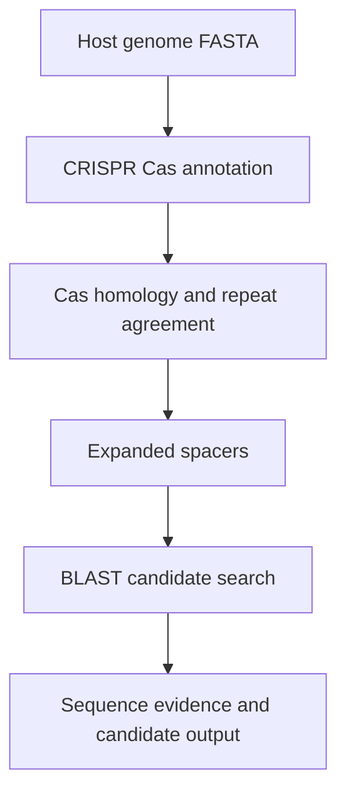
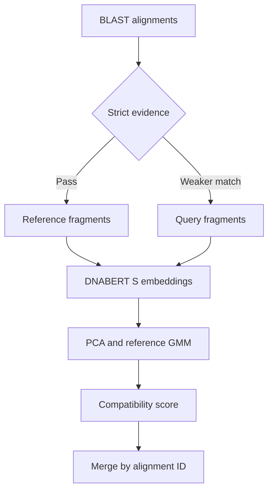

# CRISPRPHIBert workflow

## Biological pipeline





The input is a **host genome**. Its spacers are searched against candidate sequence databases to identify possible interacting phages. This is a host-to-candidate workflow; it should not be described as a generic model that takes any phage genome and classifies its host directly.

## Data contracts

| Stage | Required identifiers and information |
|---|---|
| FASTA | Unique sequence ID, non-empty IUPAC DNA sequence |
| Protein alignment | `qseqid sseqid pident length mismatch gapopen qstart qend sstart send evalue bitscore qcovs` |
| Spacer alignment | Standard 12-column BLAST outfmt 6 |
| Extracted fragment | Alignment ID, subject ID, 1-based inclusive coordinates, original strand |
| Scoring | Alignment ID and finite score in [0, 1] |
| Merge | Strict hits retained independently; weaker hits considered separately |

`pident` and `qcovs` in BLAST files are percentages. CLI thresholds in the historical implementation are fractions; compare `qcovs / 100` with `0.9`.

## Evidence rules

The display version keeps the research strict-hit criteria: E-value ≤ 1, full query coverage, no alignment gaps, and at most three mismatches. A terminal exception permits exactly one missing end base and at most two mismatches while retaining the E-value constraint. These are inherited research rules, not optimized universal thresholds.

The terminal exception is deliberately checked by its full coordinate span. A record starting at position 2 and ending two bases early must not pass merely because its start is 2.

BLAST subject coordinates are 1-based and inclusive. For Python slicing, the interval is `[min(sstart, send)-1, max(sstart, send))`, extended and clipped to the genome bounds. A reverse-strand match is reverse-complemented after extraction. The archived default flank length is **400 bases on each side**, including the matched segment between them.

## DNA representation and scoring

The recovered implementation names `zhihan1996/DNABERT-S`. Its statistical stage fits PCA with two components and a GMM with three components and tied covariance to embeddings from strict-hit fragments. It scores weaker-hit fragments with:

```text
s(x) = sigmoid(0.7 * log p_GMM(PCA(x)) - 0.3 * d_Mahalanobis(PCA(x)))
```

The reference group consists of strict candidate fragments. It is not a labelled collection of confirmed host infections. The score therefore describes compatibility with that group and requires external calibration before use as an infection probability.

The encoder adapter calls `eval()` and inference mode, excludes padding from mean pooling, and accepts both named model outputs and tuple outputs. It reads a local model directory with network downloads disabled. The official DNABERT-S example uses custom model code, so the local snapshot must be reviewed before enabling that capability. [Official implementation](https://github.com/MAGICS-LAB/DNABERT_S).

## BLAST upload workflow

`batch_spacers` groups records by both record count and total bases. `request_parameters` builds encoded FASTA submissions; `BlastClient` handles submission identifiers and retrieves JSON2 results. It enforces a 10-second spacing between server requests and a 60-second spacing for each RID. The caller schedules subsequent retrieval; the client reports when a request is too early. [NCBI guidelines](https://blast.ncbi.nlm.nih.gov/doc/blast-help/developerinfo.html).

The upload client is verified with mock responses. It has not been exercised against the live NCBI queue in this packaging run. JSON2 results remain in their native form; the offline demo reads cached 12-column alignments and does not claim to convert live JSON2 automatically.

The client records the requested database. NCBI may select a different actual database, so a real run should preserve the returned search metadata. A generic nucleotide or viral database can contain non-phage records; candidate taxonomy needs separate review.

## Reproduction levels

1. **Offline evidence demo:** Python 3.11+, no additional libraries. Fully exercised on synthetic sequence and alignment fixtures.
2. **Reference statistics:** NumPy and scikit-learn. Fully exercised on synthetic embedding fixtures.
3. **Local sequence encoding:** PyTorch, Transformers and a reviewed DNABERT-S model snapshot. Adapter supplied; real-weight inference was not run here.
4. **Complete biological workflow:** CRISPRCasTyper, MinCED, Prodigal, BLAST+, Cas/spacer databases and suitable genome inputs. Historical source preserved separately for local review; this packaging run does not reproduce its complete results.
